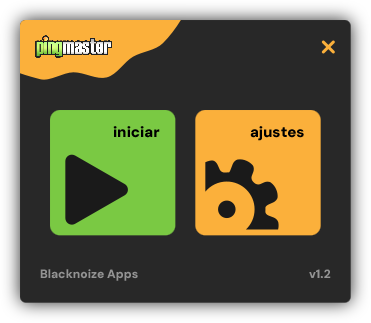
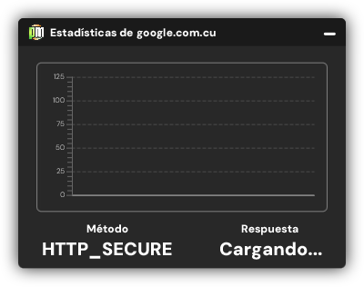
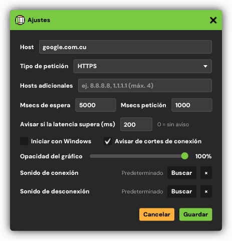
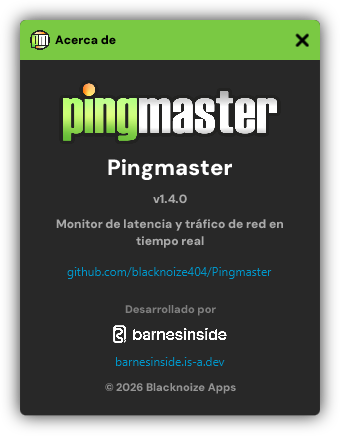
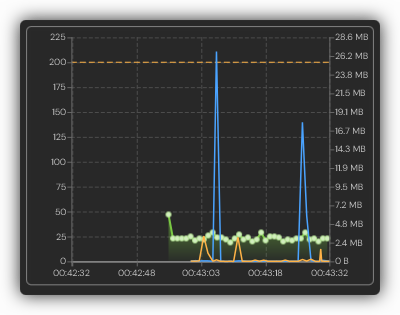
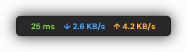

# Pingmaster

> **Un monitor de escritorio para hosts y API**: hace ping a un destino según un intervalo, muestra el
> historial de latencia en vivo y te avisa en cuanto se cae. Vive en la bandeja del sistema y no molesta.
> Funciona en Windows, Linux y macOS.

> **Web**: [barnesinside.is-a.dev/pingmaster](https://barnesinside.is-a.dev/pingmaster/)

  
  
  
  

  
  

## Qué hace

- **Monitorización continua.** Elige un host o un endpoint de API y Pingmaster lo sondea según un
  intervalo configurable: HTTP, HTTPS, ICMP o ICMP nativo.
- **Estadísticas de latencia.** Una gráfica deslizante con los tiempos de respuesta por host, además del
  método y el estado de respuesta actuales de un vistazo.
- **Velocidad de red.** Descarga y subida sobre la gráfica de latencia, medidas en el adaptador que
  elijas: el que sale a Internet (automático), todos a la vez o uno concreto, con un botón para
  refrescar la lista de interfaces.
- **Modos superpuestos.** La ventana del gráfico se reduce a un widget flotante o a una tira mínima de
  lecturas siempre encima; bloquéala y los clics la atraviesan (Windows). Ninguno sale en la barra de
  tareas.
- **Alertas de latencia.** Una línea de umbral en la gráfica y un sonido cuando las respuestas lo
  superan — con tus propios sonidos si quieres.
- **Compara y exporta.** Añade hosts extra a la misma gráfica y descarga las mediciones en CSV.
- **Notificaciones en bandeja.** Avisos emergentes de Windows y un sonido cuando el host se conecta o se
  cae, para enterarte de las caídas sin mirar la ventana.
- **Arranque con la sesión**, opacidad de las ventanas, timeouts, frecuencia de petición, método de
  ping y sonidos configurables.
- **Recuerda tus ajustes** entre ejecuciones.

## Descarga

Consigue el instalador de Windows, el paquete para tu Linux o la imagen de disco para tu Mac en
los [releases](https://github.com/blacknoize404/Pingmaster/releases):

| Distribución | Paquete |
|---|---|
| Windows 10/11 (x64) | `Pingmaster-*-windows-x64-setup.exe` (Inno Setup, instalación por usuario) |
| Debian, Ubuntu y derivadas | `pingmaster_*.deb` (`sudo apt install ./pingmaster_*.deb`) |
| Fedora, openSUSE | `pingmaster-*.rpm` (`sudo dnf install ./pingmaster-*.rpm`) |
| Cualquier otra Linux | `pingmaster-*.tar.gz`, con un `install.sh` que lo instala para tu usuario sin permisos de administrador |
| macOS (Apple Silicon) | `Pingmaster-*-macos-aarch64.dmg` |
| macOS (Intel) | `Pingmaster-*-macos-x64.dmg` |

Cada paquete trae su propio runtime de Java: no hace falta tener Java instalado.

La interfaz está en español.

## Código fuente

Los paquetes se construyen desde el repositorio privado `Pingmaster-src` con la misma cadena que
[MathUtils Studio](https://github.com/blacknoize404/MathUtils-Studio): Maven → ProGuard → jlink →
jpackage → Inno Setup / deb / rpm / dmg. Las librerías que usa son públicas:

- [NetworkUtils](https://github.com/blacknoize404/NetworkUtils) — latencia de host y monitorización de tráfico de red (Apache-2.0)
- [PersistenceUtils](https://github.com/blacknoize404/PersistenceUtils) — ajustes en fichero (Apache-2.0)
- [BI.Windows.Shell](https://github.com/blacknoize404/BI.Windows.Shell) — modo oscuro y ventanas con clic a través en Windows (Apache-2.0)

## Licencias

Pingmaster en sí es propietario y de uso gratuito: mira [LICENSE](LICENSE) y [NOTICE.md](NOTICE.md)
para los componentes de terceros que llevan los instaladores.
