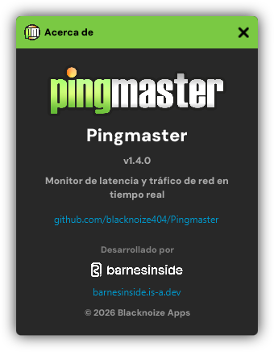
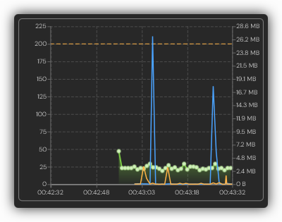
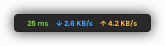

# Pingmaster

> **A desktop monitor for hosts and APIs**: it pings a target on a schedule, shows the live latency
> history and warns you the moment it goes down. It lives in the system tray and stays out of the way.
> It runs on Windows, Linux and macOS.

> **Website**: [barnesinside.is-a.dev/pingmaster](https://barnesinside.is-a.dev/pingmaster/)

> **Documentación en español**: [README.es.md](README.es.md)

  
  
  
  

  
  

## What it does

- **Continuous monitoring.** Choose a host or API endpoint and Pingmaster probes it on a configurable
  schedule — HTTP, HTTPS, ICMP or native ICMP.
- **Latency statistics.** A rolling chart of response times per host, plus the current method and
  response state at a glance.
- **Network speed.** Download and upload speed over the latency chart, measured on the adapter you
  choose: the one that reaches the Internet (automatic), all of them, or a single one — with a button
  to refresh the list of interfaces.
- **Overlay modes.** The chart window shrinks into a floating widget or a minimal readout strip that
  stays on top — lock it and clicks pass straight through (Windows). Both stay out of the taskbar.
- **Latency alerts.** A threshold line on the chart and a sound when responses cross it, with your
  own sounds if you like.
- **Compare and export.** Pin extra hosts on the same chart and download the measurements to CSV.
- **Tray notifications.** Windows balloon notifications and a sound when the host connects or drops,
  so you notice outages without watching the window.
- **Autostart on login**, adjustable window opacity, configurable timeouts, request rate and ping method.
- **It remembers your settings** between runs.

## Download

Get the installer for Windows, the package for your Linux or the disk image for your Mac
from the [releases](https://github.com/blacknoize404/Pingmaster/releases):

| Distribution | Package |
|---|---|
| Windows 10/11 (x64) | `Pingmaster-*-windows-x64-setup.exe` (Inno Setup, per-user install) |
| Debian, Ubuntu and derivatives | `pingmaster_*.deb` (`sudo apt install ./pingmaster_*.deb`) |
| Fedora, openSUSE | `pingmaster-*.rpm` (`sudo dnf install ./pingmaster-*.rpm`) |
| Any other Linux | `pingmaster-*.tar.gz`, with an `install.sh` that installs it for your user without administrator rights |
| macOS (Apple Silicon) | `Pingmaster-*-macos-aarch64.dmg` |
| macOS (Intel) | `Pingmaster-*-macos-x64.dmg` |

Every package brings its own Java runtime — no Java installation needed.

The application window is in Spanish.

## Source

The packages are built from the private `Pingmaster-src` repository with the same pipeline that ships
[MathUtils Studio](https://github.com/blacknoize404/MathUtils-Studio): Maven → ProGuard → jlink →
jpackage → Inno Setup / deb / rpm / dmg. The libraries it uses are public:

- [NetworkUtils](https://github.com/blacknoize404/NetworkUtils) — host latency and network traffic monitoring (Apache-2.0)
- [PersistenceUtils](https://github.com/blacknoize404/PersistenceUtils) — file-based settings (Apache-2.0)
- [BI.Windows.Shell](https://github.com/blacknoize404/BI.Windows.Shell) — Windows dark mode and click-through windows (Apache-2.0)

## Licenses

Pingmaster itself is proprietary, free to use — see [LICENSE](LICENSE) and [NOTICE.md](NOTICE.md) for
the third-party components inside the installers.
